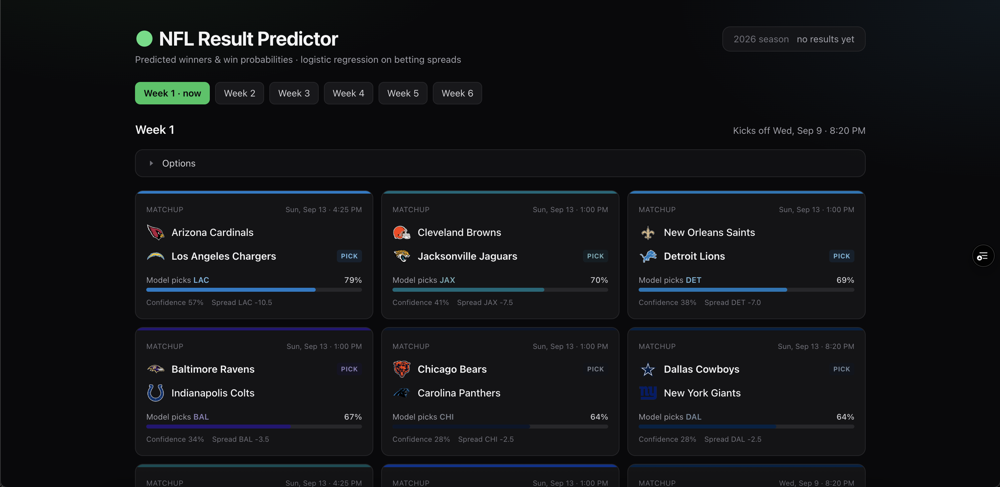

# NFL Result Predictor



A machine learning system for predicting NFL game outcomes, built for the **2026 season**.  
Live at **[nfl-result-predictor.vercel.app](https://nfl-result-predictor.vercel.app)**

---

## What it does

- Fetches schedules, scores, betting lines and team / player / injury data from
  [nflverse](https://github.com/nflverse) (via `nfl_data_py` and nflverse's CSV releases)
- Builds pre-game features — turnovers, EPA, Elo, starting-QB form, injuries and more —
  using only games played before each kickoff
- Backtests every combination of feature groups against past seasons to see
  what actually predicts winners (the **feature lab**)
- Predicts upcoming weeks with the best combination found (a logistic regression)
- Grades every pick against the real result and serves it all on a web dashboard
  deployed on Vercel, refreshed twice a week by GitHub Actions

---

## Web App

The dashboard is deployed at **https://nfl-result-predictor.vercel.app**

Features:
- Lands on the **current NFL week** by date. A week runs Tuesday through Monday
  Night Football (US Eastern), so Tuesday switches to the next week. The current
  week is labelled **now**.
- Week pills show each finished week's **correct-pick %** (hover for correct/graded)
- Matchup cards with team logos, full names, predicted winner, win-probability bar;
  spreads that were projected rather than posted are labelled **Proj. spread**
- **Last week's results**: final scores with each pick graded ✓ / ✗
- Season-to-date and per-week record (correct picks / graded games)
- Options panel: adjustable pick threshold (0.40–0.60), sort, CSV download

Results are joined from the schedule by `game_id`, so once a week's games are
played and the schedule is refreshed (the [weekly update](#weekly-updates) does
this) the picks are graded automatically. Ties aren't graded.

---

## Weekly updates

[`.github/workflows/weekly-update.yml`](.github/workflows/weekly-update.yml) runs
every **Tuesday and Saturday at 16:00 UTC** (9 AM PDT / 8 AM PST; GitHub may start
scheduled runs a few minutes late), and can be started by hand from
**Actions → Weekly update → Run workflow**. Each run:

1. Runs `Season26/scripts/weekly_update.py`, which re-downloads
   `schedule_2026.csv` (so finished games get graded) and re-predicts the current
   week plus the next 7 weeks with `predict_lab.py`, **skipping any week where a
   game has already been played**. A week's picks are therefore locked once its
   first game is final, and graded exactly as they were made.
2. Fails without committing if any file other than the schedule, the prediction
   CSVs and `lab_model.*` changed, or if predictions changed for a week already in
   progress.
3. Commits the changes straight to `main` as `github-actions[bot]`, which
   triggers a Vercel deploy. The run summary shows last week's record and the
   season record.

Tuesday's run picks up Monday night's result; Saturday's picks up late line moves
and newly announced starting quarterbacks.

---

## Models

The live site has used two models this season. Each week's predictions file
records which one produced it: lab-model files have a `model` column, baseline
files don't.

| Weeks (2026) | Model | Produced by |
|---|---|---|
| 1–5 | Baseline: spread only | `get_week.py` (predictions committed 2026-08-26) |
| 6 onward | Lab model: spread + turnovers + QB | `predict_lab.py`, via the weekly update |

There's no automatic switch between them: a week's file is whatever the last
script to write it produced. Since the weekly update only re-predicts weeks that
haven't started, weeks 1–5 keep their baseline picks.

### Baseline model (weeks 1–5)

`src/features.py`, `src/train.py`, `src/predict.py`

| Detail | Value |
|--------|-------|
| Algorithm | Logistic regression (`class_weight=balanced`), StandardScaler |
| Features | `spread_home` (betting spread, home perspective) and `is_home` |
| Training data | 2025 season, completed games (228 train / 57 test) |
| Held-out test accuracy / ROC-AUC | 66.7% / 0.717 ([`baseline_metrics.txt`](Season26/models/reports/baseline_metrics.txt)) |

`is_home` is a constant 1 (every row is framed from the home side), so it carries
no signal: the model is a calibrated function of the betting line, and its pick is
always the favorite.

### Lab model (week 6 onward)

`src/feature_lab.py`, `src/qb_injury_features.py`, `scripts/predict_lab.py`.
The fitted settings are saved in
[`lab_model.json`](Season26/models/artifacts/lab_model.json).

| Detail | Value |
|--------|-------|
| Algorithm | Logistic regression, StandardScaler |
| Feature groups | spread, turnovers, qb_quality, qb_vs_team, qb_change (+ home field) |
| Columns | `home_field`, `spread_line`, `giveaways_diff`, `takeaways_diff`, `qb_epa_diff`, `qb_vs_team_diff`, `qb_change_diff` |
| Training data | 2023, 2024, 2025 seasons: 838 games (ties excluded) |
| Lookback rule | only this season's played games + the 3 seasons before it |

What the columns mean (every `_diff` is home team minus away team):

- `home_field` — 1 for a true home game, 0 at a neutral site
- `spread_line` — the betting line as the home team's expected margin
- `giveaways_diff` / `takeaways_diff` — interceptions + fumbles lost, and the
  opponent's, averaged over each team's previous 8 games
- `qb_epa_diff` — the starting QB's EPA per play over his previous 16 games (on
  any team), shrunk toward −0.10 with a 150-play prior so a QB with little history
  rates near backup level
- `qb_vs_team_diff` — that rating minus the average rating of whoever started the
  team's previous 8 games, so a backup stepping in shows up as a drop
- `qb_change_diff` — 1 if the starter differs from the team's previous game

**Lookback rule.** Predictions for season S use only S's games played so far and
the 3 seasons before it. Every feature (rolling stats, QB history) is rebuilt from
that slice, and the model trains on those 3 seasons. For 2026, that means 2023–2026
data, trained on 2023–2025.

**Upcoming games.** Each team's features are its values *as of now*. A game with
no posted line yet gets a spread projected from this season's posted lines (team
power ratings plus home field; `src/features.py: project_spreads`), and a team with
no announced starter is assumed to start its most recent QB. Both are flagged in
the predictions CSV (`spread_source`, `qb_assumed`) and the dashboard labels
projected spreads. Re-running the prediction replaces them once the real line and
starter are known.

---

## Feature search

`scripts/feature_search.py` scores combinations of feature groups against past
seasons to find which predict winners best.

| Run | Feature groups | Combinations | Validation (ranks) | Holdout (reported only) |
|---|---|---|---|---|
| Base | 11 team-stat groups | 2,047 (every combination) | 2010–2019 | 2020–2025 |
| `--extras` | 17 (+ 4 QB, 2 injury groups) | 3,213 (up to 4 groups each) | 2016–2019 | 2020–2025 |

The 11 base groups are spread, turnovers, touchdowns, point_diff, epa, yards,
sacks, penalties, win_pct, elo and rest. The extras add qb_change, qb_experience,
qb_quality, qb_vs_team, injuries_count and injuries_snap. The extras run starts
in 2016 because snap counts (used to weight injuries) begin in 2013.

**No lookahead.** The split is by time. Each test season is predicted by a model
trained on the 3 seasons before it, with features rebuilt from that 4-season
slice under the lookback rule above. Combinations are ranked on the validation
seasons only. The holdout seasons are never used to choose anything, so the
holdout number is the honest estimate.

### Results (holdout 2020–2025, 1,688 games)

Validation is 2010–2019 for base-run rows and 2016–2019 for extras rows (QB,
injury and "extras" combinations).

| Model | Validation | Holdout |
|---|---|---|
| Always pick the home team | | 53.9% |
| Always pick the betting favorite | | 66.6% |
| Spread alone | 66.2% | 66.6% |
| Best base combination: spread + turnovers + epa + penalties + win_pct + rest | 67.0% | 66.5% |
| Best extras combination: spread + point_diff + epa + injuries_count | 67.1% | 66.4% |
| **Live model:** spread + turnovers + qb_quality + qb_vs_team + qb_change | 66.8% | **67.1%** |
| Best without the spread (base): turnovers + touchdowns + sacks + elo + rest | 65.4% | 63.4% |
| Best without the spread (extras): turnovers + point_diff + elo + qb_experience | 65.8% | 64.9% |

The live model comes from the extras report's add-on comparison: adding the three
QB groups to spread + turnovers raised validation by 0.5 points and holdout by 0.4.
Its validation number is on the extras run's 2016–2019 seasons, where the spread
alone scored 65.9%. It has 5 groups, so it sits outside the 4-group exhaustive
search, and its numbers come from that add-on table. In the exhaustive search, 121
of the 3,213 combinations also edged out the spread alone on both validation and
holdout, all by margins within noise.

Each group on its own (base run; holdout): spread 66.6%, elo 63.9%, point_diff
62.1%, epa 61.4%, touchdowns 61.1%, yards 60.2%, win_pct 59.2%, sacks 57.8%,
rest 54.2%, penalties 53.6%, turnovers 53.4%. From the extras run: qb_quality
63.4%, qb_experience 60.2%, qb_change 55.7%, qb_vs_team 55.5%, injuries_count
54.3%, injuries_snap 53.8%.

**Bottom line:** the best models match the betting favorite (~66.6%) within noise;
none of them beats it. One standard error on the holdout is about 1.2 points, so
the live model's +0.5 isn't a proven edge. Without the spread, the best
combinations reach ~64–65% on the holdout. Turnovers are weak on their own but appear in
14 of the 15 top base combinations. Win % on its own works best looking back
1 season and gets worse with 2–3.

Full results, including sensitivity sweeps (training window, win % lookback,
rolling window) and how often each model disagrees with the favorite:
[`feature_search.md`](Season26/models/reports/feature_search.md),
[`feature_search_extras.md`](Season26/models/reports/feature_search_extras.md).
Every combination's scores are in the matching `_combos.csv` files.

### Injuries and weather

Injury features (players listed Out or Doubtful, as a raw count and weighted by
recent snap share) were tested in the extras run and didn't help. They aren't used
for live predictions, because no injury report exists for games weeks away
(`predict_lab.py` refuses them). Weather is not implemented.

---

## Results

### 2026 season (live)

The dashboard computes the live record (season to date and per week) straight
from the committed predictions and the latest schedule. See the header and week
pills on the [live site](https://nfl-result-predictor.vercel.app), or
`GET /api/weeks` → `records`. It isn't copied here because it changes every week.

### Baseline backtest

Running the baseline model over full past seasons and checking each pick against
the game that was actually played (`Season26/scripts/backtest.py`, which scores
only the baseline model):

| Season | Games | Winner accuracy | ROC-AUC | "Always pick home" | "Pick the favorite" |
|--------|-------|-----------------|---------|--------------------|---------------------|
| 2023 (out-of-sample) | 285 | **67.4%** | 0.693 | 56.5% | 67.4% |
| 2024 (out-of-sample) | 285 | **70.5%** | 0.756 | 54.7% | 70.5% |
| 2025 (in training set) | 285 | 66.0% | 0.722 | 53.3% | 66.0% |
| **Pooled 2023–2025** | 855 | **68.0%** (581/855) | 0.725 | 54.9% | 68.0% |

Its accuracy matches "just pick the Vegas favorite" to three decimals every
season: the spread is its only informative feature. It does clearly beat always
picking the home team (~55%). The lab model's backtest is the feature search above.

### How accuracy is calculated

For each completed game the model outputs `P(home team wins)`. The **predicted
winner** is the home team when that probability is `>= 0.5` (the
`--threshold`), otherwise the away team. A pick is **correct** when the
predicted winner is the team that actually won (equivalently,
`pred_home_win == home_win`, since the label is framed from the home side).

```
accuracy = correct winner picks / completed games
```

Only games with a final score are counted (unplayed games have no outcome to
check). In `backtest.py`, `home_win` is `home_score > away_score`; the dashboard
and the feature search leave ties out entirely. `roc_auc` is scikit-learn's
ROC-AUC of the raw `P(home win)` against the actual `home_win` outcome — it
rewards the model for ranking games by confidence, not just for the 0.5 cutoff.

- `always_pick_home` — accuracy if you predicted the home team every game.
- `pick_favorite` — accuracy of taking whichever team the spread favors
  (games with a pick'em line of 0 excluded).

Out-of-sample = seasons the model was **not** trained on; those numbers are the
honest estimate of future accuracy.

---

## Project Structure

```
NFLResultPredictor/
├── .github/workflows/
│   └── weekly-update.yml       # Tue + Sat: grade results, re-predict, commit to main
├── api/                        # Vercel serverless functions (auto-detect highest SeasonNN/)
│   ├── _nfl.py                 # shared: load CSVs, join results, grade picks, current week
│   ├── predictions.py          # GET /api/predictions?week=X&threshold=Y -> games + grading
│   └── weeks.py                # GET /api/weeks -> weeks, current/previous week, records
├── public/
│   ├── index.html              # Web dashboard frontend
│   ├── teams.json              # team names / colors / divisions
│   └── logos/                  # 32 team logo PNGs (built, committed)
├── Season26/                   # Current season (mirror this folder each year)
│   ├── config.yaml             # season: 2026; baseline settings (train_seasons: [2025])
│   ├── data/
│   │   ├── raw/                # schedule_2026.csv (scores + lines), schedule_train_*.csv
│   │   ├── interim/            # feature-lab download cache (git-ignored, re-fetchable)
│   │   └── processed/          # predictions_2026_wkN.csv
│   ├── models/
│   │   ├── artifacts/          # baseline_logreg.pkl, lab_model.pkl + lab_model.json
│   │   └── reports/            # baseline_metrics.txt, backtest.txt, feature_search*.md/.csv
│   ├── scripts/
│   │   ├── weekly_update.py    # Refresh schedule + re-predict unstarted weeks (lab model)
│   │   ├── predict_lab.py      # Train the lab model, predict given weeks
│   │   ├── feature_search.py   # Backtest feature combinations (--extras for QB/injury)
│   │   ├── backtest.py         # Score the baseline model vs completed seasons
│   │   ├── refresh_all.py      # Retrain the baseline model
│   │   ├── get_week.py         # Baseline predictions for one week (legacy)
│   │   └── build_team_assets.py # Download team logos + write public/teams.json
│   ├── src/
│   │   ├── data.py             # Schedule fetching & I/O (cwd-independent paths)
│   │   ├── features.py         # Baseline features + projected spreads
│   │   ├── feature_lab.py      # Lab features, season windows, walk-forward backtest
│   │   ├── qb_injury_features.py # Starting-QB and injury features
│   │   ├── train.py            # Baseline training
│   │   └── predict.py          # Baseline prediction
│   └── requirements.txt        # Model-pipeline deps (pinned)
├── Season25/                   # Prior season (kept for history)
├── devserver.py                # Local preview (emulates vercel.json routing)
└── vercel.json
```

---

## Local Development

### Prerequisites
- Python 3.11+
- Node.js 18+ (for Vercel CLI)

### Setup

```bash
git clone https://github.com/alexmekhail/NFLResultPredictor.git
cd NFLResultPredictor

python3.11 -m venv Season26/.venv
source Season26/.venv/bin/activate      # macOS/Linux
# .\Season26\.venv\Scripts\Activate.ps1  # Windows

pip install -r Season26/requirements.txt
```

Scripts resolve their paths relative to the season folder, so they can be run
from anywhere (from inside `Season26/` or as `python Season26/scripts/...` from
the repo root) and always read/write under `Season26/`. Downloads for the feature
lab are cached in `Season26/data/interim/feature_lab/`; the in-progress season is
re-fetched on every prediction run.

### Run the weekly update locally

```bash
python Season26/scripts/weekly_update.py              # current week + next 7
python Season26/scripts/weekly_update.py --ahead 3    # current week + next 3
python Season26/scripts/weekly_update.py --today 2026-10-17   # pretend it's another date
```

The same thing the GitHub Actions workflow runs (without the commit). It refreshes
`schedule_2026.csv` and calls `predict_lab.py` for every week in range that hasn't
had a game played.

### Predict specific weeks with the lab model

```bash
python Season26/scripts/predict_lab.py --weeks 6 7 8 9
python Season26/scripts/predict_lab.py --weeks 7 --groups spread turnovers   # try other groups
```

Trains on the 3 seasons before the current one and writes
`Season26/data/processed/predictions_2026_wkN.csv` plus `models/artifacts/lab_model.*`.
It doesn't check whether a week has started, so prefer `weekly_update.py` for
live weeks. Injury groups are rejected because there's no injury report for
future weeks.

### Run the feature search

```bash
python Season26/scripts/feature_search.py             # 11 team-stat groups, all 2,047 combinations
python Season26/scripts/feature_search.py --extras    # + QB & injury groups, up to 4 per combo
```

Writes `Season26/models/reports/feature_search[_extras].md` and the matching
`_combos.csv`. Options: `--val-start`, `--val-end`, `--holdout-end`, `--window`
(rolling games), `--win-seasons`, `--max-size`. The base run takes about 2
minutes once data is cached.

### Backtest the baseline model against completed seasons

```bash
python Season26/scripts/backtest.py                        # default: 2023, 2024, 2025
python Season26/scripts/backtest.py --seasons 2022 2023 2024
```

Writes `Season26/models/reports/backtest.txt`. See
[How accuracy is calculated](#how-accuracy-is-calculated).

### Retrain the baseline model / baseline predictions (legacy)

```bash
python Season26/scripts/refresh_all.py
python Season26/scripts/get_week.py --season 2026 --week 1
```

`refresh_all.py` retrains the baseline on `train_seasons` (see
`Season26/config.yaml`) and saves `baseline_metrics.txt`. `get_week.py` writes a
week's predictions with the **baseline** model, overwriting that week's file, so
don't run it on weeks the lab model now predicts.

### Rebuild team logos / metadata (once per season)

```bash
python Season26/scripts/build_team_assets.py
```

Downloads a logo per team into `public/logos/` and writes `public/teams.json`.
Team branding rarely changes, so this only needs re-running on a rebrand or
relocation.

### Preview the web dashboard locally

```bash
python devserver.py            # http://localhost:8000
```

Emulates the `vercel.json` routing (`/api/*` → the Python handlers, everything
else → `public/`) so you can test the dashboard without the Vercel CLI.

---

## Deploy

```bash
npm i -g vercel
vercel --prod
```

The `api/` directory contains Python serverless functions; `public/` serves the
static frontend. Pushes to `main` (including the weekly update's commits) deploy
automatically through Vercel's GitHub integration.

---

## Roadmap

- Beat the betting line, not just match it: nothing tested so far does (see
  [Feature search](#feature-search))
- Weather data (wind, temperature, precipitation)
- Advanced models (XGBoost / LightGBM ensembles) that can capture feature interactions
- Probability calibration (reliability curves for the lab model's win percentages)
- Injury information that exists before a week's report (e.g. long-term injured
  reserve) so injuries can be used for future weeks
